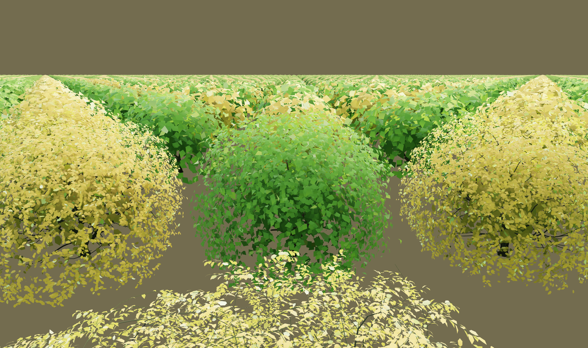
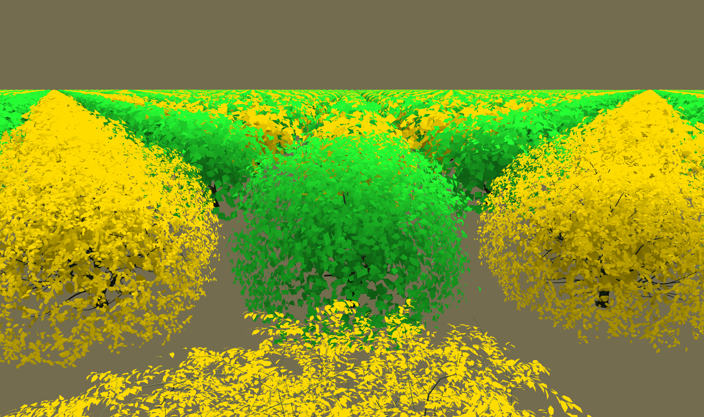
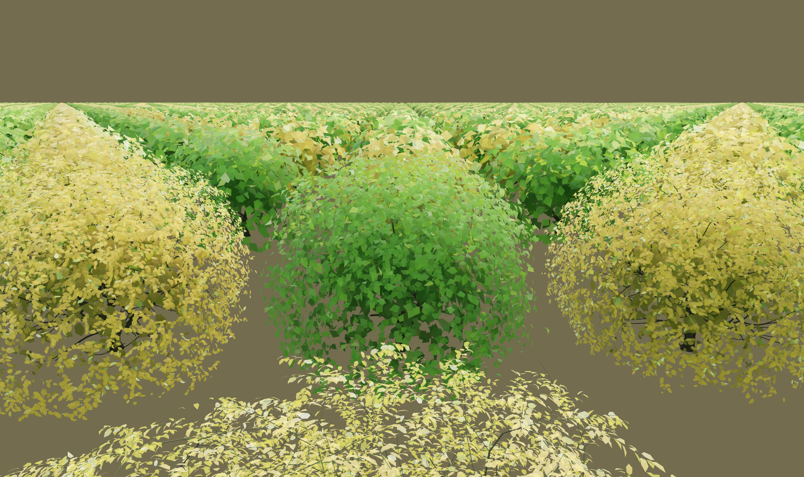

# TreeLayer performance and analytical color measurements

Measured on 2026-11-19 with the public synthetic citrus fixture: 20,000 input trees,
1312 × 779 CSS pixels, DPR 2 (2624 × 1558 drawing buffer), LOD bias 0, animated light
breeze, native headed Chromium 151.0.7922.34, ANGLE Metal on Apple M2 with 8 GiB RAM.
Deck 10.0.0-alpha.1 and Luma 10.0.0-alpha.14 were shared by all three versions.
Each published renderer used its own published SelectionPulseExtension.

The implementation measured here is `95fe66432e521915730ae6f73b4945dde5ddd5a6`.
Published package gitHeads were `830c6989ac8c45a423f97c1c9e06765661564acd`
(alpha.1) and `98e1c9898628e3641f5808acf728f1dab1e9566c` (alpha.2).
[Numeric summaries and raw frame intervals](./2026-11-19-m2.json) accompany this report.

## Matched presentation timing

Two repetitions ran in this order: alpha.1, alpha.2, branch, branch, alpha.2, alpha.1.
Each path used a fresh page, 60 warmup frames and 120 measured intervals. The dive also
traversed its full camera path before warmup. Ground, shadows and GPU timer queries
were disabled; an unselected SelectionPulseExtension remained attached. Colors used
the default natural mode and opacity 1 in every primary timing run.

| Path | alpha.1 FPS range | alpha.2 FPS range | Branch FPS range |
| --- | ---: | ---: | ---: |
| Overview | 60.0 | 60.0–60.1 | 60.0 |
| Close tree | 29.0–29.3 | 21.1–21.4 | 26.3–33.8 |
| Camera dive and return | 32.6–33.5 | 24.1–24.6 | 23.8–28.5 |
| RGB update every frame, fixed overview | 58.1 | 16.7–17.1 | 60.1 |

These short runs on a working desktop show meaningful variation, especially in the
branch close view. They establish the observed range, not a device-independent FPS
promise. The dive ranges overlap; this patch does not establish a sustained dive-speed
improvement or restore every alpha.1 performance characteristic.

## Attribution

**Selection changes the rendering path.** Alpha.2 disables mature-leaf shading and
conservative spatial leaf culling whenever any extension is attached. The branch
allows the known color-only SelectionPulseExtension, keeps the general fallback for
other implementations and subclasses, and bypasses weight texture reads at zero pulse
strength. Opaque attached leaves retain opaque blending because the pulse preserves alpha.

In the fixed close view, median submitted indices fall from 20,434,908 to 15,950,544
(21.9%), while draw calls remain 44. Rendered regression checks compare optimized and
general shaders at a fixed wind phase, including selected colors, extension changes,
picking and non-pickable layers. This is a reduction in submitted indexed work, not a
measurement of unique post-cache vertex shader invocations.

Additional single-repetition controls (same dimensions, ground absent) expose the
remaining costs. These controls are separate from the repeated table above:

| Control | alpha.2 close / dive FPS | Branch close / dive FPS |
| --- | ---: | ---: |
| No selection extension, shadows off | 56.7 / 33.3 | 53.4 / 26.9 |
| Selection attached, shadows on | 16.1 / 18.1 | 28.3 / 16.2 |

The extension still carries a substantial cost on the branch. A global performance
gain is not established: the no-extension and shadowed dive controls are slower in
the branch run. Shadow passes add eight draw calls per frame in both versions; close
tracked allocation rises to 205.1 MiB in alpha.2 and 205.6 MiB on the branch.

**RGB edits were doing geometry work.** Alpha.2 spends a median 53.8–55.3 ms per update
in TreeLayer.updateState for the tint path: source reads alone take 34.7–35.6 ms,
regrouping 1.6–1.7 ms and detail selection 9.7–10.5 ms. These nested timers must not be
added together. The branch takes 4.9–7.4 ms, writes appearance state only and records
zero source-read, regroup and detail-selection calls. Both versions write the state
texture once per frame and submit the same 4,200,000 overview indices. This change
avoids repeatedly creating geometry-source objects as well as recomputing detail.

**Camera math remains material.** During the moving dive, median detail-selection CPU
time remains 7.8–10.7 ms on the branch (11.1–12.8 ms in the corresponding alpha.2 runs).
The close view has no per-frame detail-selection work. `_drawLayersMs` records draw
submission only, not total CPU time; neither it nor RAF intervals directly measure
GPU execution. Sampled GPU-query experiments were excluded from this comparison because
queries materially affected cadence on this setup.
A separate Chromium CPU sampling capture, including warmup, identifies
`updatePhotorealDetail`, `classifyTreeFrustum` and `updateNearLeaves` as the leading
non-idle self-time locations. Garbage collection appears in that capture but is below
those camera/detail loops. This sampling run is excluded from the FPS comparison.

**The newer renderer retains more GPU geometry.** Peak tracked allocation in the close
view is 100.7 MiB for alpha.1, 169.4 MiB for alpha.2 and 169.9 MiB on the branch.
During the dive it reaches 102.3, 169.5 and 178.4 MiB respectively. This patch does not
reduce that allocation. These are Luma-tracked allocations, not whole-device memory.
Chromium's estimated tint-path heap peaks at about 554–556 MiB in alpha.2 and
314–315 MiB on the branch; those heap estimates are not direct GC measurements.

## Analytical palette behavior

The natural palette applies botanical pigment/desaturation, lifecycle color shifts and
per-channel filmic encoding. These intentionally move bright class colors toward a
botanical appearance. The new opt-in `canopyColorMode: 'analytical'` uses neutral light
intensity and hue-preserving display encoding throughout shell, transition, coarse,
fine, macro and airborne foliage. Bark and crops retain their own materials.

Browser pixel tests cover yellow `[255, 220, 0]` and green `[30, 200, 40]`, unlit and
lit scenes, opacity, selection, picking and real shell/leaf transitions on WebGL2 and
WebGPU. Unlit analytical foliage reproduces authored RGB. Alpha remains optical
coverage, and Deck opacity remains per-surface transparency. A separate WebGPU fix
premultiplies output for Deck's default blend state, preventing excessive brightness
and hue clipping through translucent overlap.

The synthetic Bright captures use the same class colors and opacity 1 before and
after; only the branch opts into analytical mode. Realistic captures use natural mode
and opacity 0.7 on both versions. Both pairs use identical dimensions, camera, density,
lighting and wind time 12. These labels describe this fixture, not a customer scene.

| Capture | Published alpha.2 | Branch |
| --- | --- | --- |
| Bright, opacity 1 |  |  |
| Realistic, opacity 0.7 |  |  |

## Reproduction and limits

From the repository root, use the same command for each renderer:

```sh
corepack yarn node dev/tree-field-bench/bench.mjs --headed --profile \
  --frame-timing-only --selection --ground 0 --shadows 0 \
  --width 1312 --height 779 --dpr 2 --count 20000 \
  --frames 120 --warmup 60 --paths overview,tree,dive,tint \
  --label source --out /tmp/tree-source.json
```

For a published comparison, set `TREE_LAYER_ENTRY` to the extracted package's
`dist/tree-layer/tree-layer.js`, with its peer dependencies resolving to the same
workspace installation. The harness resolves the selection extension from that same
package. See the [benchmark options](../README.md) for profiling and capture flags.

All primary runs report the native M2 renderer, exactly 120 draws, the requested
physical canvas, zero measured GL errors and no warmup GL errors. The ground receiver
was omitted because this fixture's SolidPolygon ground produces a pre-existing
`uniformBlockBinding` GL error on this local Luma setup. An alpha.1 shadow-on attempt
also failed to compile with the newer fixture's custom lighting effect; no alpha.1
shadow-on speed ratio is claimed.

The fixture excludes imagery, terrain and application overhead. These results do not
measure a customer's complete map or establish its before/after FPS. Full-map GPU
allocation cannot be attributed entirely to TreeLayer from these numbers.

Applications using metric palettes can opt into analytical mode while retaining their
existing selection extension, coverage and opacity. Keep natural mode for botanical
palettes. No release, merge or consumer integration is part of this benchmark.
