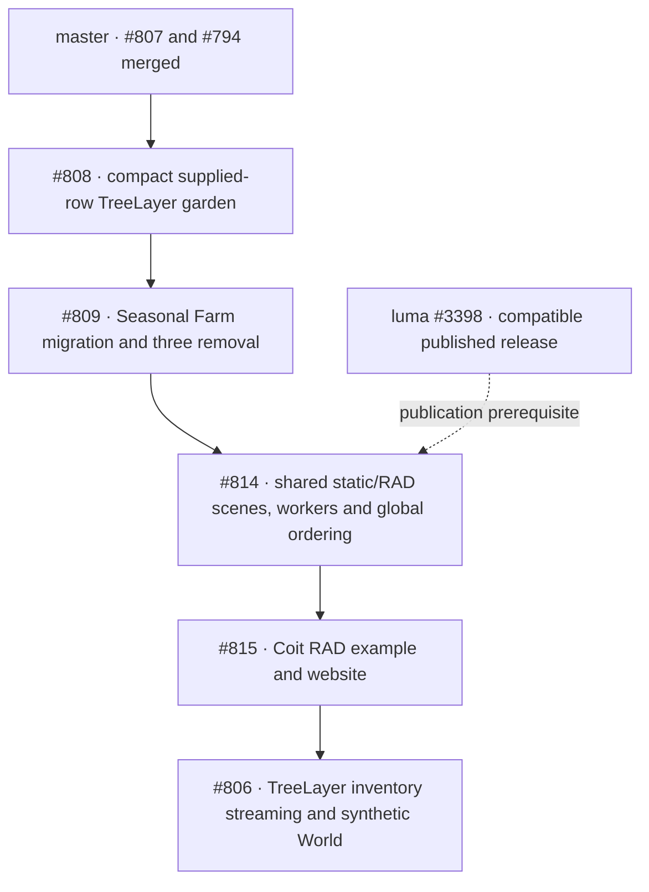

# TreeLayer, Composite SplatLayer and Coit stack

Revised October 13, 2026. #807 (prepared SplatLayer) and #794 (native TreeLayer) have landed.
The remaining landing order is **#808 → #809 → #814 → #815 → #806**. Regular TreeLayer examples
and removal of the deprecated three workspace can land before geographic inventory streaming.
Coit has no TreeLayer API prerequisite; the linear stack resolves shared integration files.

| PR | Base branch | Head branch |
| --- | --- | --- |
| [#808](https://github.com/visgl/deck.gl-community/pull/808) | `master` | `codex/citrus-tree-lab` |
| [#809](https://github.com/visgl/deck.gl-community/pull/809) | `codex/citrus-tree-lab` | `codex/remove-three-module` |
| [#814](https://github.com/visgl/deck.gl-community/pull/814) | `codex/remove-three-module` | `codex/splat-scene-foundation` |
| [#815](https://github.com/visgl/deck.gl-community/pull/815) | `codex/splat-scene-foundation` | `codex/coit-community` |
| [#806](https://github.com/visgl/deck.gl-community/pull/806) | `codex/coit-community` | `codex/tree-forest-performance` |

## Milestones

#808 adds one small garden using the merged supplied-row TreeLayer API: eight species,
seasons, crown spread, crops, wind, standard lighting and picking. #809 migrates Seasonal Farm
and removes `@deck.gl-community/three`, including consumers, docs, navigation and legacy redirects.
Comparison renderers, films, benchmark reports and the 20K Forest demo are omitted.

#814 adds URL/Blob/static/RAD sources, workers, shared residency and sorted Cartesian domains.
#815 adds Coit using that public scene runtime. Those scene features are absent at #809.
Historical Coit evidence covers a real 50,937,127-row asset and bounded first coverage; it does
not prove settled full detail or hardware performance.

#806 finally adds `getTileData` inventory streaming, numeric coverage transitions, frame budgets,
cache statistics and the deprecated WorldTreeLayer wrapper. The World demo and its source/tests/
website/docs land together here. Its synthetic 3.04 trillion count is a latent address space;
only bounded requested pages and submitted crown work are resident. These APIs are absent in
#808 through #815.

## Validation and publication

Each PR must pass root install/build, strict public consumers, relevant Node/example/GPU tests,
its website workspace install/build and final formatting. Recheck hosted CI and review threads
on each actual head before landing. Land parents first; after a squash merge, restack and
revalidate descendants against the updated master. Current source and CI evidence are separate
from historical validation snapshots.

Removing the published three package requires a major release after compatible native
TreeLayer/SplatLayer packages are available. Published old versions remain unchanged.
The scene branch carries a development-only Yarn backport of merged luma #3398; package
publication requires a compatible luma release, patch removal and packaged-consumer proof.
Neither release gate prevents reviewing or landing the earlier regular examples/removal.

Software GPU fixtures prove their rendering contracts, not hardware speed. Sorted geospatial/
globe rendering, hard GPU byte accounting, joint best-first selection across independent RAD
hierarchies and scalable WebGL2 ordering remain explicit scene limits.
