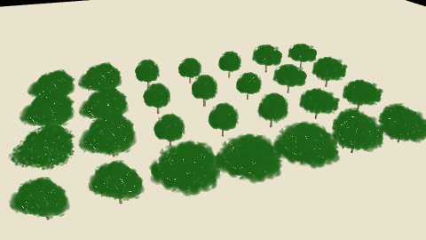

# SelectionPulseExtension

<p class="badges">
  
  
</p>

A deck.gl layer extension that pulses the color of selected objects on the GPU.



Selection is a per-object value written from `getSelected`; the pulse itself is two uniforms. A
selection change writes one value per object, and each animation frame only updates the uniforms:
while the selection pulses, no accessor reruns and no attribute is uploaded.

```ts
import {ScatterplotLayer} from '@deck.gl/layers';
import {SelectionPulseExtension} from '@deck.gl-community/extensions';
import {TreeLayer} from '@deck.gl-community/layers';

const selectionPulse = new SelectionPulseExtension();

new ScatterplotLayer({
  id: 'sites',
  data: sites,
  getPosition: d => d.position,
  getFillColor: d => colorForCategory(d),
  extensions: [selectionPulse],
  getSelected: d => selectedIds.has(d.id),
  updateTriggers: {getSelected: [selectedIds]}
});

new TreeLayer({
  id: 'grove',
  data: trees,
  getTree: d => d.tree,
  extensions: [selectionPulse],
  getSelected: d => selectedIds.has(d.id),
  updateTriggers: {getSelected: [selectedIds]},
  pulseColor: [255, 205, 40],
  pulseStrength: 0.6
});
```

## Properties

### `getSelected` ([Accessor&lt;boolean | number&gt;](https://deck.gl/docs/developer-guide/using-layers#accessors), optional)

Whether each object is selected. `true` or `1` pulses it fully, `false` or `0` leaves its color
unchanged, and values in between pulse it partly. Default `false`.

As with any deck.gl accessor, a new function does not rerun it: change `updateTriggers.getSelected`
when the selection changes.

### `pulseColor` (Color, optional)

The RGB that selected objects blend toward at the peak of each pulse. Alpha is ignored; objects
keep their own alpha. Default `[0, 0, 0]`, which dims them.

### `pulseStrength` (number, optional)

The blend toward `pulseColor` at the peak, from 0 to 1. Default `0.4`: with the default color, a
selected object dims to 60% of its brightness and back.

### `pulsePeriod` (number, optional)

Milliseconds per pulse. `0` holds a steady tint at `pulseStrength` and requests no redraws.
Default `1500`.

### `pulsePhase` (number, optional)

Offset into the pulse as a fraction of `pulsePeriod`. Default `0`.

### `pulseTime` (number | null, optional)

The pulse clock in milliseconds. `null` follows deck.gl's animation timeline (`context.timeline`);
a number renders that instant, for example in tests and screenshots. Default `null`.

## Animation

The blend at time `t` is `pulseStrength * (1 - cos(2π (t / pulsePeriod + pulsePhase))) / 2`: it
starts at the object's own color, reaches `pulseStrength` after half a period and returns.

While `pulseTime` is `null` and any object a layer draws is selected, that layer requests a redraw
on every frame. With nothing selected, a numeric `pulseTime` or a `pulsePeriod` of `0`, it requests
none. In an interleaved `MapboxOverlay` on a MapLibre or Mapbox map, the request repaints the map.

## Shading, lighting and picking

The color is blended in the vertex shader at deck.gl's `DECKGL_FILTER_COLOR` hook. On meshes lit
per fragment, such as `SimpleMeshLayer` and `TreeLayer`, the lighting then shades the blended color;
on layers lit per vertex, such as `ColumnLayer`, it blends the lit color. With the default dark
`pulseColor` both give the same dimming.

The extension composes with `LightingEffect`, including shadow-casting lights: pulsing objects
keep casting shadows, and the shadows do not pulse. Picking is unaffected, and `autoHighlight` or
`highlightedObjectIndex` draws `highlightColor` over the pulsing color.

## Supported layers

Verified in WebGL2 render tests:

| Layer | Notes |
| --- | --- |
| `ScatterplotLayer`, `ColumnLayer`, `PointCloudLayer`, `IconLayer`, `TextLayer` | |
| `PathLayer`, `LineLayer`, `ArcLayer` | Also with `PathStyleExtension` dashes. |
| `SolidPolygonLayer`, `PolygonLayer`, `GeoJsonLayer` | Fills, extrusions and outlines. |
| `SimpleMeshLayer` | |
| `TreeLayer`, `SplatLayer` | Also on WebGPU. `SplatLayer` with `transparency: 'sorted'` does not pulse. |

Other deck.gl layers whose vertex shader calls `DECKGL_FILTER_COLOR` work the same way, as do
custom layers that call it. Composite layers pass the extension to their sub-layers and apply
`getSelected` to their own data rows, so `getSelected` receives the original object. It composes
with extensions such as `DataFilterExtension`.

Not supported:

- `TripsLayer` in deck.gl 9.4: its shaders replace the injections of every extension.
- Aggregation layers such as `HexagonLayer` and `HeatmapLayer`, which draw bins rather than objects.
- deck.gl's core layers on WebGPU: deck.gl 9.4 has no WGSL color hook. The extension logs a warning
  and leaves them unchanged.

`SplatLayer`'s Gaussians and `TreeLayer`'s wood, crops and canopy already use the 16 vertex
attributes that WebGL2 and WebGPU guarantee, so on those layers the extension reads the selection
from a small texture by instance index instead of from a vertex attribute.

## Adding and removing the extension

deck.gl initializes extensions when it creates a layer. `SelectionPulseExtension` also initializes
when it is added to an existing layer. deck.gl does not finalize an extension removed from a live
layer, so keep it on the layer and stop the pulse with `getSelected` or `pulseStrength: 0`, or
give the layer a new `id` when you remove it.

## Migrating from accessor-driven pulses

Rebuilding a layer on each animation frame with a pulse value in a color accessor's
`updateTriggers` reruns that accessor and re-uploads the color of every object on every frame. Move
the selection to `getSelected` and keep the color accessor's triggers to the inputs that change
colors:

```ts
// Before: every visible object is recolored on every frame.
getFillColor: d => (selectedIds.has(d.id) ? dim(baseColor(d), pulse) : baseColor(d)),
updateTriggers: {getFillColor: [colorTheme, selectedIds, pulse]}

// After: colors are written once; the selection pulses on the GPU.
getFillColor: baseColor,
extensions: [new SelectionPulseExtension()],
getSelected: d => selectedIds.has(d.id),
updateTriggers: {getFillColor: [colorTheme], getSelected: [selectedIds]}
```

[Source](https://github.com/visgl/deck.gl-community/tree/master/modules/extensions/src/selection-pulse-extension)
